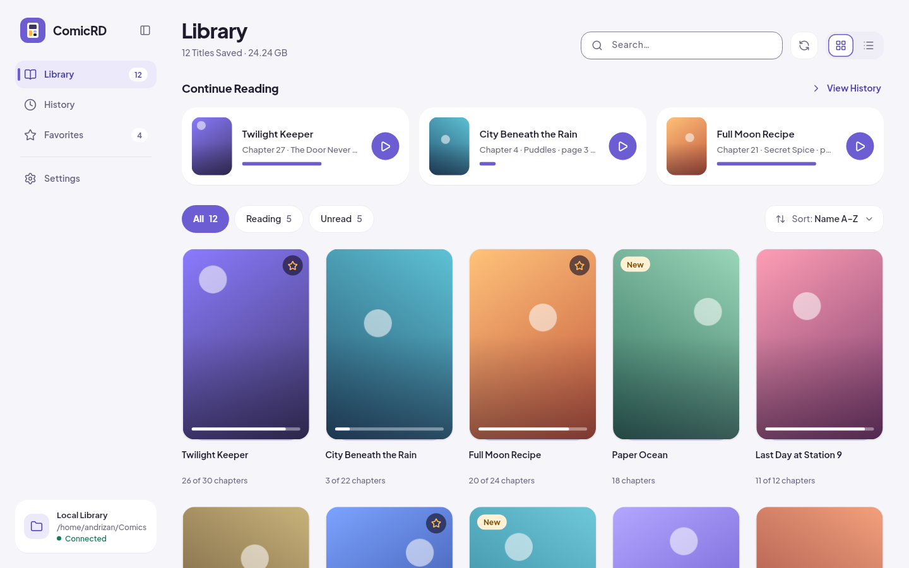
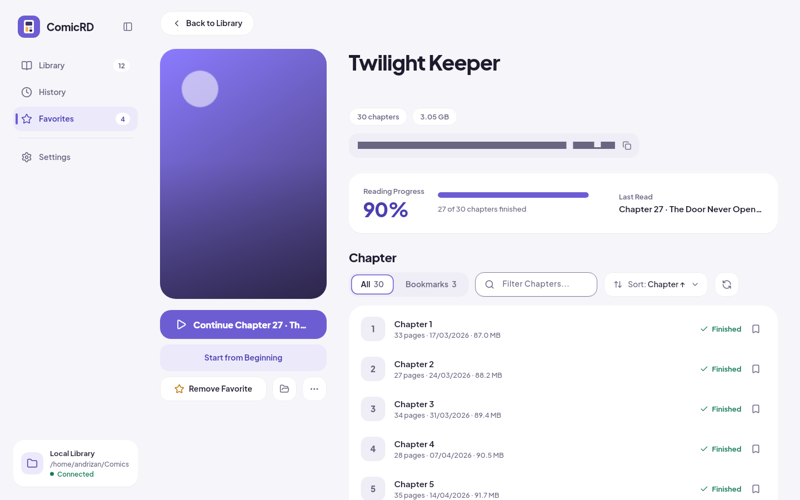
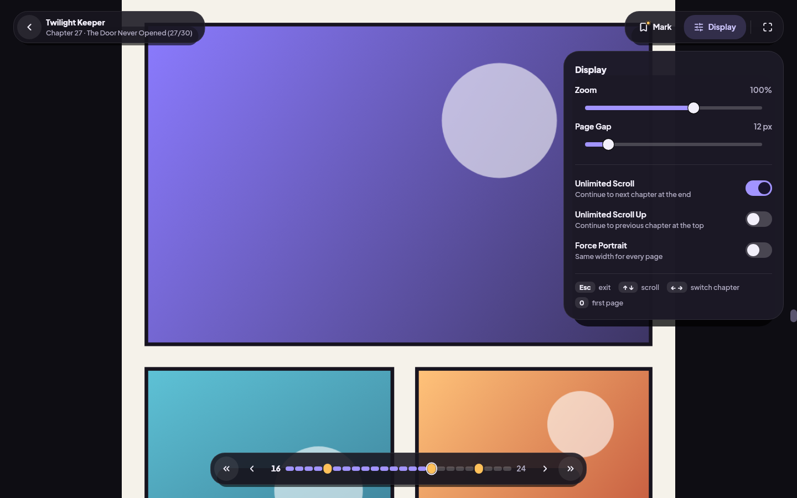
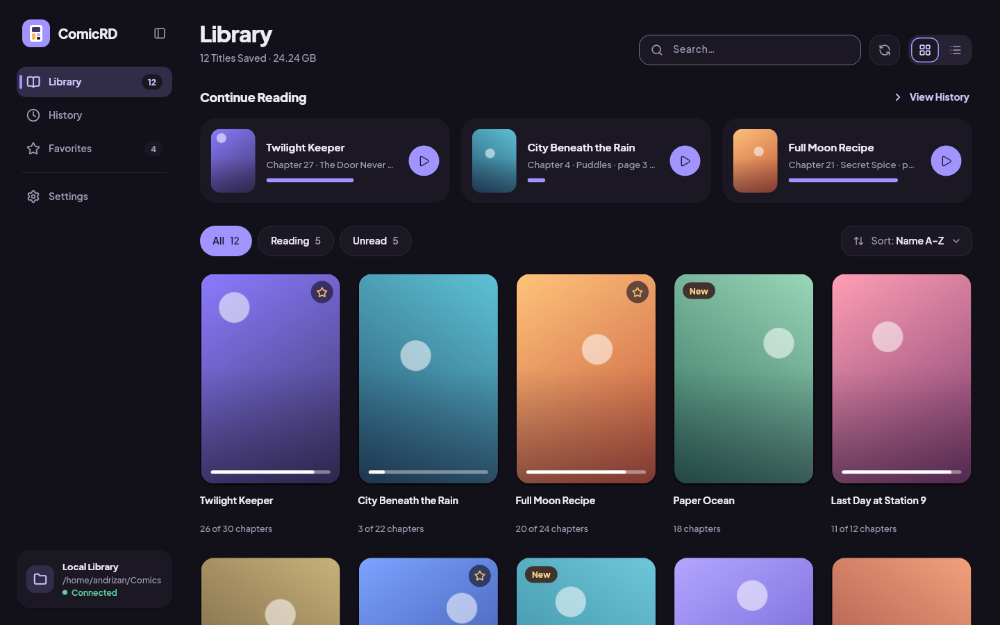
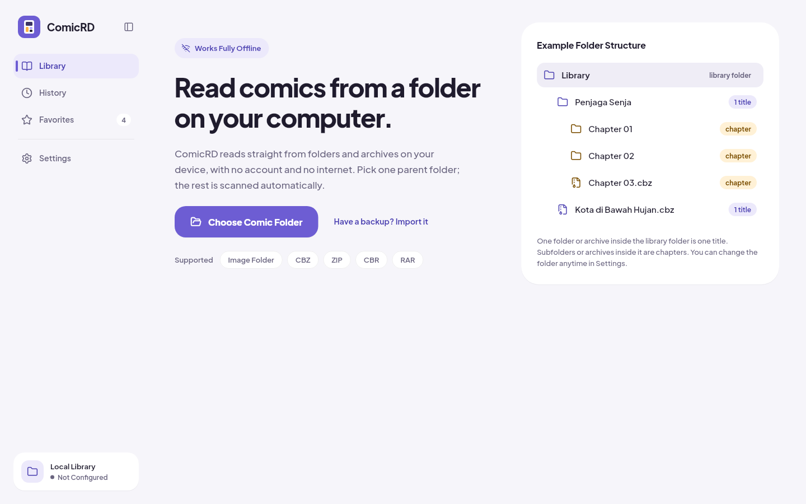

# ComicRD

Desktop comic reader for local libraries — no account, no internet. Flutter
owns the desktop UI; Rust owns filesystem discovery, archives, SQLite
metadata, progress, bookmarks, history, backup/import, and the reader image
pipeline.



| Comic detail | Reader with the Display panel |
| --- | --- |
|  |  |

| Dark theme | First run |
| --- | --- |
|  |  |

Screenshots are rendered from sample data by `app_flutter/test/screenshots_test.dart`
(see [Screenshots](#screenshots)). Technical details: `docs/technical.md`.

## Features

- Pick one library folder; the shallow listing is instant, a full scan runs in the background
- Folder, ZIP/CBZ, and RAR/CBR support; nested folder pages to depth 3
- JPEG, PNG, WebP, GIF, BMP, and AVIF pages
- Library with a continue-reading shelf, grid and list cards, unread/reading filters, search and sort
- History (continue or read again), favorites, chapter bookmarks and page bookmarks
- Comic detail: progress card, last read, chapter list with natural ordering (`06.5` after `06`)
- Vertical reader: floating toolbar, Display panel (zoom, page gap, unlimited scroll, portrait mode),
  Mark panel (page/chapter bookmark, favorite), segmented page bar with bookmark markers,
  fullscreen, auto-saved progress, prev/next chapter
- Keyboard: `Esc` close, `↑ ↓` / `PgUp PgDn` scroll, `← →` switch chapter, `0` / `Home` first page,
  `Ctrl+T` theme, `Ctrl+L` language
- On-demand page bytes with bounded prefetch/cache; on-demand thumbnails (200 MB LRU disk cache)
- SQLite settings/progress/bookmarks/history; backup export/import; Optimize Data (purge stale + VACUUM + report)
- Light and dark themes, English and Indonesian, auto-update via GitHub Releases; Linux packaging/AUR; Windows installer

## Design

The UI follows a soft, modern system: a lavender-cream ground with white
cards and tinted shadows, radii 12–28, one 44 px control height, accent
reserved for the active state and amber for bookmark/"new" markers, set in
Plus Jakarta Sans. Tokens live in `app_flutter/lib/utils/forui_theme.dart`
(`ComicReaderFTheme`, `ComicReaderColors`, `AppShape`, `AppIcons`); the shared
widgets (cards, buttons, chips, segmented control, sort menu, switch, slider,
search field, progress bar, badges, cover thumbnail) live in
`app_flutter/lib/widgets/soft_ui.dart`. Every text pairing is at least
4.5:1 and every UI pairing at least 3:1 in both themes.

## Status

Main app flows are done: library listing/scan, chapters, reader, progress,
bookmarks, history, settings, backup/import, thumbnails, and Optimize Data.
Reader loads page bytes on demand with 2048px tiling and a stable scrollbar.
Smoke tested on Windows and Linux with Linux packaging available. macOS
target exists but still needs a native smoke test.

## Install

### Arch Linux / CachyOS

```bash
paru -S comicrd-bin
# or: yay -S comicrd-bin
```

### Windows Installer

Download `*-setup.exe` from GitHub Releases. Per-user install, no admin needed.

### Linux Tarball

```bash
tar -xzf comicrd-2.8.3-linux-x86_64.tar.gz
./comicrd-2.8.3-linux-x86_64/opt/comicrd/ComicRD
```

### Local Pacman Package

```bash
./scripts/package-arch-local.sh 2.8.3
sudo pacman -U dist/arch/comicrd-bin-2.8.3-1-x86_64.pkg.tar.zst
```

## Build From Source

### Requirements

- Flutter desktop SDK (3.47+, Dart ^3.12.1)
- Rust toolchain (`rustc 1.98`)
- `flutter_rust_bridge_codegen` 2.13.0, `cargo-expand`
- Platform desktop build tools

#### Linux (Arch/CachyOS)

```bash
sudo pacman -S --needed base-devel clang cmake ninja pkgconf gtk3 dav1d
```

Debian/Ubuntu: `build-essential clang cmake ninja-build pkg-config libgtk-3-dev libdav1d-dev`.

#### Windows

Visual Studio 2022 with the "Desktop development with C++" workload, plus
dav1d for AVIF decoding:

```powershell
# Option A — vcpkg
vcpkg install dav1d:x64-windows-static
$env:PKG_CONFIG_PATH = "$env:VCPKG_ROOT\installed\x64-windows-static\lib\pkgconfig"

# Option B — meson, or run scripts/setup-dav1d.ps1 (installs to %LOCALAPPDATA%\dav1d)
```

#### macOS

```bash
brew install dav1d pkg-config
```

### Development Commands

```bash
cargo test
flutter analyze
flutter test
flutter run -d linux
flutter pub get
cargo build -p comicrd_bridge --release
```

## Run Locally

```bash
flutter pub get
flutter run -d linux
```

CMake calls `scripts/build-native-bridge.sh` automatically. Hot reload is
Dart-only — restart the app fully for Rust changes.

Manual bridge rebuild (missing bridge at startup / force fresh copy):

```bash
./scripts/build-native-bridge.sh --platform linux --configuration Debug --destination app_flutter/build/linux/x64/debug/bundle/lib
./scripts/build-native-bridge.sh --platform linux --configuration Release --destination app_flutter/build/linux/x64/release/bundle/lib
```

Windows uses `scripts/build-native-bridge.ps1`; macOS copies
`libcomicrd_bridge.dylib` via Xcode.

When `crates/comicrd_bridge/src/api.rs` changes:

```bash
flutter_rust_bridge_codegen generate --config-file flutter_rust_bridge.yaml
```

No codegen needed for `comicrd_core`-only changes, but still restart the app.

### Desktop Builds

```bash
flutter build linux --release
flutter build windows --release
flutter build macos --release
ISCC.exe /D"AppVersion=2.8.3" app_flutter\windows\installer\comicrd-setup.iss
./scripts/package-linux.sh 2.8.3
```

### Continuous Integration

`.github/workflows/desktop-build.yml` runs the quality checks (`cargo test`,
`flutter analyze`, `flutter test`) on every push and pull request, builds
the Linux, Windows and macOS bundles on tags (`v*`) or manual dispatch,
publishes the GitHub Release and updates the AUR package. The toolchain
setup, the Windows dav1d build/cache and the tag → version resolution are
composite actions under `.github/actions/`, so each lives in one place.
`codeql.yml` scans the Rust workspace.

## Repository Layout

```text
comicrd_flutter/
├── app_flutter/              # Flutter desktop UI
│   ├── lib/
│   │   ├── api/              # Dart facade over generated bridge APIs
│   │   ├── pages/            # library, comic, reader, settings
│   │   ├── routes/
│   │   ├── state/            # Riverpod providers and settings/strings
│   │   ├── utils/            # theme tokens, formatting
│   │   ├── widgets/          # soft_ui building blocks
│   │   └── bridge_generated.dart
│   ├── test/                 # widget/unit tests + screenshot tool
│   └── pubspec.yaml
├── crates/
│   ├── comicrd_core/         # Reusable Rust core
│   └── comicrd_bridge/       # flutter_rust_bridge API crate
├── docs/                     # technical notes, screenshots, active plan
├── scripts/
└── flutter_rust_bridge.yaml
```

No Tauri/React/WebView — Flutter desktop + Rust core/bridge only.

## Architecture

Flutter: routes, Riverpod state, theme, localization, desktop behavior, rendering.
Rust: source checks/scanning, chapter discovery, SQLite, progress/bookmarks/history,
backup, page/image caching, MIME + dimension probing.

```text
Flutter UI → ComicRdApi facade → FRB bindings → comicrd_bridge → comicrd_core
```

UI code calls `app_flutter/lib/api/comicrd_api.dart`, not generated functions directly.

## Data Model And Listing

Filesystem is the source of truth (`list_library_comics_raw`: depth-1 walk, one
top-level folder/archive = one comic, 30s entry cache, sort by name/date).
DB stores scan results and reader state only — unlisted/unscanned comics report
`0/0/0` counts. Explicit scan upserts to SQLite; opening a comic discovers
chapters on demand. Chapters are natural-sorted by stem (`06.5` after `06`).

## Database Maintenance

Settings → Optimize Data: deletes missing comics/chapters + orphaned
progress/bookmarks/favorites/covers, skips unavailable library roots, runs
`VACUUM` + WAL checkpoint, reports size before/after and freed space.
Thumbnail cache (`app_data_dir/thumbnails`) trims on write; Optimize Data purges
orphans immediately.

## Flutter State

`rawLibraryComicsProvider` fetches from Rust; `filteredLibraryComicsProvider`
applies query/view-mode sync; `libraryComicsProvider` + `libraryPaginationProvider`
handle pagination. Search is debounced, scroll offsets throttled. The sidebar
selection derives from the route and `libraryPreferencesProvider`; settings
are hydrated once by the shell into the app, library and reader notifiers.

## Reader Image Pipeline

Metadata-first, bytes-on-demand: Rust lists pages, probes width/height, splits
tall pages into ≤2048px tiles; Flutter renders flattened tiles with stable
extents and an exact-total sliver (no scrollbar jumps); tile bytes load only on
build/prefetch. Progress/bookmarks stay page-based. The reader chrome (toolbar,
panels, page bar) is an overlay rebuilt on its own version counter, so opening a
panel never relayouts the page strip.

- Folder: depth 3, ignores dotfiles/`__MACOSX`/`thumbs.db`/`desktop.ini`
- ZIP/CBZ: read entry bytes on demand
- RAR/CBR: extract-once session dir under app-data, served from disk, LRU (max 2), swept on startup
- Natural sort (`2.png` before `10.png`); bounded memory (prefetch ±2 tiles, 2 page sources, 16 raw tiles)

## Bridge Workflow

Boundary: `crates/comicrd_bridge/src/api.rs`. Generated files are committed
(`frb_generated.rs`, `api.dart`, `frb_generated.dart`, `frb_generated.io.dart`).
Keep the bridge minimal: no duplicate/constant/unused fields.

## Tests

```bash
cargo test
flutter analyze
flutter test
flutter test --coverage   # writes app_flutter/coverage/lcov.info
```

Rust tests live in `crates/comicrd_core/tests/` (per concern); Dart tests in
`app_flutter/test/`: shared widgets (`soft_ui_test.dart`), the app shell and
sidebar, the library page (welcome, shelf, filters, list, history, favorites),
the comic page, the reader pipeline and chrome, the settings page, the
strings tables and the library-source actions. `test/support/fake_api.dart`
is the in-memory `ComicRdApi` the widget tests share.

### Screenshots

The README images are produced headlessly, with the real fonts and sample
data, by a gated test:

```bash
cd app_flutter
COMICRD_SCREENSHOTS=1 flutter test test/screenshots_test.dart   # → build/screenshots/*.png
```

Copy the ones you want into `docs/screenshots/`.

## License

MIT. See [LICENSE](LICENSE).
